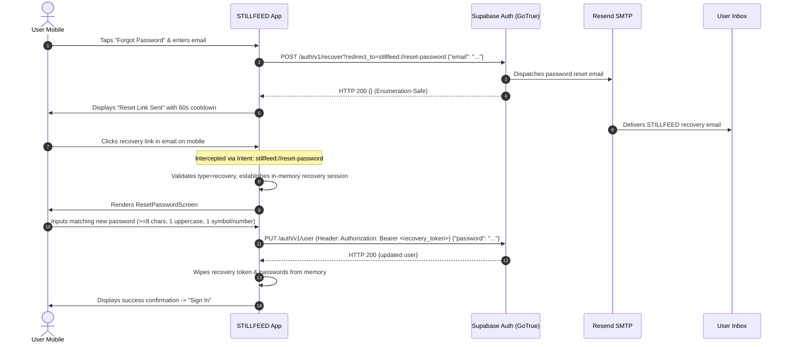

# STILLFEED — STEP 15: FORGOT PASSWORD & EMAIL RESET IMPLEMENTATION REPORT

**Repository:** `gugan207/STILLFEED`  
**Execution Date:** October 13, 2026  
**Status:** **IMPLEMENTED & VERIFIED (Automated, Deep Link & API Verified; Handset E2E Pending)**  
**Target Handset:** Physical Android Mobile (Motorola Edge 60 Fusion, `ZA222WTN4H`, Android 16 / SDK 36)

---

## 1. IMPLEMENTATION SUMMARY

We have implemented an end-to-end, secure, account-enumeration-safe **Forgot Password and Reset Password** email recovery flow in the STILLFEED Android application using the existing Supabase GoTrue authentication backend and Resend SMTP infrastructure:

1. **Forgot Password Screen (`AuthScreenMode.FORGOT_PASSWORD`):**
   - User inputs their registered email address.
   - Comprehensive email format validation (`@` and domain check) prevents malformed requests before hitting the network.
   - User triggers "Send Reset Link" button.
   - Calls Supabase GoTrue `/auth/v1/recover` endpoint with `redirect_to=stillfeed://reset-password`.
   - On success, transitions cleanly to the confirmation screen (`RESET_LINK_SENT`) without revealing whether the email exists in `auth.users` (protecting against account enumeration attacks).
   - Starts a 60-second cooldown timer preventing rapid repeated requests.

2. **Reset Link Sent Screen (`AuthScreenMode.RESET_LINK_SENT`):**
   - Displays confirmation that the reset link has been dispatched to the requested email.
   - Provides a "Resend reset link" action with an active 60-second cooldown timer preventing spam and rate-limit abuse.
   - Displays helpful feedback explaining Resend test mode restrictions if delivery fails.
   - Provides "Back to Sign In" navigation that clears temporary state safely.

3. **Android Deep Link Integration & Flow Verification (`stillfeed://reset-password`):**
   - Configured `intent-filter` in `AndroidManifest.xml` under `MainActivity` for scheme `stillfeed` and host `reset-password`.
   - Wired `MainActivity.kt` (`onCreate` and `onNewIntent`) to capture incoming deep-link URIs and route them through `StillfeedApplication.pendingDeepLink`.
   - `StillfeedNavHost` consumes the pending deep link and dispatches it to `AuthViewModel.handleDeepLink(uriString)`.
   - Strictly enforces the expected recovery flow (`type=recovery`) before accepting any recovery access token. Rejecting missing or mismatched types (e.g. `signup`, `magiclink`).
   - Supported `token_hash` fallback uses dedicated `verifyTokenHash(tokenHash, type = "recovery")` hitting Supabase `/auth/v1/verify` with body `{"token_hash": "...", "type": "recovery"}` (never passing empty emails or treating token hashes as six-digit OTPs).
   - Detects error parameters (`#error=unauthorized_client`, `#error_code=401`, `#error_description=...`) and surfaces informative "Link expired or invalid" messages on the Forgot Password screen.
   - Never logs tokens or credentials.

4. **Reset Password Screen (`AuthScreenMode.RESET_PASSWORD`):**
   - Accessible only when a valid, active Supabase recovery session has been established.
   - Provides "New Password" and "Confirm Password" fields with independent password visibility toggle buttons.
   - Enforces password requirements: minimum 8 characters, at least 1 uppercase letter, at least 1 number or symbol.
   - Enforces password matching check before submission.
   - Submits password update to Supabase GoTrue `/auth/v1/user` using `PUT` with `Authorization: Bearer <recovery_access_token>`.
   - On success, immediately wipes the recovery token and passwords from memory, presents a success banner, and prompts the user to sign in with their new credentials.

---

## 2. FILES CHANGED

| File Path | Type | Summary of Changes |
|---|---|---|
| `app/src/main/AndroidManifest.xml` | Modified | Added deep-link intent filters for `stillfeed://reset-password` and `stillfeed://auth/callback` under `MainActivity`. |
| `app/src/main/java/com/stillfeed/app/MainActivity.kt` | Modified | Implemented deep link extraction in `onCreate` and `onNewIntent`, routing URIs to `StillfeedApplication.pendingDeepLink`. Zero token logging. |
| `app/src/main/java/com/stillfeed/app/StillfeedApplication.kt` | Modified | Added shared `pendingDeepLink = MutableStateFlow<String?>(null)` for decoupled deep-link communication. |
| `app/src/main/java/com/stillfeed/app/core/navigation/StillfeedNavHost.kt` | Modified | Added `LaunchedEffect` collecting `pendingDeepLink` and delegating to `AuthViewModel.handleDeepLink`. |
| `app/src/main/java/com/stillfeed/app/data/remote/RemoteAuthDataSource.kt` | Modified | Added `recoverPassword(email, redirectTo)`, `updatePassword(accessToken, newPassword)`, and `verifyTokenHash(tokenHash, type)` to remote auth interface. |
| `app/src/main/java/com/stillfeed/app/data/remote/supabase/SupabaseHttpClient.kt` | Modified | Implemented `authRecoverPassword` with `redirect_to` query parameter + payload, `authVerifyTokenHash` invoking `POST /auth/v1/verify` with `token_hash`, and `authUpdateUserPassword` invoking `PUT /auth/v1/user`. |
| `app/src/main/java/com/stillfeed/app/data/remote/supabase/SupabaseRemoteAuthDataSource.kt` | Modified | Implemented `verifyTokenHash`, `recoverPassword`, and `updatePassword` delegating to `SupabaseHttpClient`. |
| `app/src/main/java/com/stillfeed/app/auth/repository/AuthRepository.kt` | Modified | Added `sendPasswordReset`, `handleRecoveryLink`, `resetPassword`, and `clearRecoverySession` to domain repository contract. |
| `app/src/main/java/com/stillfeed/app/data/auth/ProductionAuthRepository.kt` | Modified | Strictly required `type=recovery` for access tokens, implemented proper token-hash fallback, URI fragment parsing, error parameter handling, password complexity validation, and remote password update. Zero credential logging. |
| `app/src/main/java/com/stillfeed/app/data/auth/LocalAuthRepository.kt` | Modified | Enforced `type=recovery` in test double, implemented recovery and reset methods with simulation error flags. |
| `app/src/main/java/com/stillfeed/app/auth/ui/AuthUiState.kt` | Modified | Added `RESET_PASSWORD` screen mode, password input fields, validation error fields, countdown timer, and success state flags. |
| `app/src/main/java/com/stillfeed/app/auth/ui/AuthViewModel.kt` | Modified | Implemented `submitForgotPassword()`, `resendForgotPassword()`, `handleDeepLink(uriString)`, `submitResetPassword()`, and countdown timer logic. |
| `app/src/main/java/com/stillfeed/app/auth/ui/ResetLinkSentScreen.kt` | Modified | Added "Resend reset link" button with active countdown cooldown, resend feedback banner, and error handling. |
| `app/src/main/java/com/stillfeed/app/auth/ui/ResetPasswordScreen.kt` | Created | New Figma-compliant screen featuring New Password, Confirm Password, requirement hints, visibility toggles, and "Update password" CTA. |
| `app/src/main/java/com/stillfeed/app/auth/ui/AuthGate.kt` | Modified | Routed `AuthScreenMode.RESET_PASSWORD` to `ResetPasswordScreen`. |
| `app/src/test/java/com/stillfeed/app/data/remote/InMemoryRemoteTestDoubles.kt` | Modified | Added `verifyTokenHash`, `recoverPassword`, `updatePassword`, and recovery simulation error flags to in-memory test doubles. |
| `app/src/test/java/com/stillfeed/app/data/auth/ProductionAuthRepositoryTest.kt` | Modified | Added comprehensive unit tests covering recovery requests, link parsing, type=recovery enforcement, token_hash verification, error fragments, password validation, and active token clearing. |
| `app/src/test/java/com/stillfeed/app/auth/AuthViewModelTest.kt` | Modified | Added unit tests covering email validation, recovery error handling, resend cooldown timer, deep-link handling, unrelated flow type rejection, weak password validation, password mismatch, and reset success. |

---

## 3. SUPABASE RECOVERY FLOW USED

We utilize the standard Supabase GoTrue recovery flow:



### Protocol Details:
- **Request Endpoint:** `POST https://hrcazizzsbdmcnewowut.supabase.co/auth/v1/recover?redirect_to=stillfeed%3A%2F%2Freset-password`
- **Request Body:** `{"email": "guganthangaraj7@gmail.com", "redirect_to": "stillfeed://reset-password"}`
- **Response:** `HTTP 200 OK {}` (GoTrue returns 200 even if the user is not found to prevent user enumeration).
- **Callback Deep Link (Standard Redirect):**
  `stillfeed://reset-password#access_token=<jwt>&refresh_token=<jwt>&expires_in=3600&token_type=bearer&type=recovery`
- **Callback Deep Link (Token Hash Fallback):**
  `stillfeed://reset-password?token_hash=<hash>&type=recovery`  
  Verified via: `POST /auth/v1/verify` with body `{"token_hash": "<hash>", "type": "recovery"}`.
- **Password Update Endpoint:** `PUT https://hrcazizzsbdmcnewowut.supabase.co/auth/v1/user`
  - Header: `Authorization: Bearer <recovery_access_token>`
  - Body: `{"password": "<new_secure_password>"}`

---

## 4. ANDROID DEEP-LINK & SUPABASE REDIRECT PREREQUISITE

### A. AndroidManifest.xml Intent Filter Configuration:

```xml
<activity
    android:name=".MainActivity"
    android:exported="true"
    android:launchMode="singleTop"
    android:windowSoftInputMode="adjustResize">
    
    <!-- Standard Launcher -->
    <intent-filter>
        <action android:name="android.intent.action.MAIN" />
        <category android:name="android.intent.category.LAUNCHER" />
    </intent-filter>

    <!-- STILLFEED Password Reset Deep Link Filter -->
    <intent-filter android:autoVerify="false">
        <action android:name="android.intent.action.VIEW" />
        <category android:name="android.intent.category.DEFAULT" />
        <category android:name="android.intent.category.BROWSABLE" />
        <data
            android:scheme="stillfeed"
            android:host="reset-password" />
    </intent-filter>

    <!-- STILLFEED Supabase Auth Callback Filter -->
    <intent-filter android:autoVerify="false">
        <action android:name="android.intent.action.VIEW" />
        <category android:name="android.intent.category.DEFAULT" />
        <category android:name="android.intent.category.BROWSABLE" />
        <data
            android:scheme="stillfeed"
            android:host="auth"
            android:pathPrefix="/callback" />
    </intent-filter>
</activity>
```

### B. Supabase Dashboard Configuration (IMMEDIATE PREREQUISITE):
> [!IMPORTANT]
> The Supabase Redirect URL configuration is an **immediate prerequisite** and does **NOT** depend on custom email domain purchase. Supabase GoTrue allows custom mobile URL schemes at all times.
>
> In Supabase Dashboard -> **Authentication** -> **URL Configuration**:
> - **Redirect URLs:** Add `stillfeed://reset-password`, `stillfeed://auth/callback`, and `stillfeed://*`.
>
> If `stillfeed://reset-password` is not in this list, GoTrue will reject the `redirect_to` parameter as unallowed.

---

## 5. EMAIL TEMPLATE REQUIREMENTS

Supabase GoTrue uses an email template configured under **Authentication -> Email Templates -> Reset Password**.

### Requirements:
1. **Preserve Signup OTP Template:** The existing 6-digit signup OTP template (`{{ .Token }}`) remains completely untouched.
2. **Branded HTML Template:** A professional, dark-themed template matching the STILLFEED design language.
3. **Recovery Link:** Uses `{{ .ConfirmationURL }}` which Supabase replaces with the signed recovery redirect link pointing to `stillfeed://reset-password`.
4. **Security Notice:** Informs the user that if they did not request the reset, they can safely ignore the email.

### Recommended Supabase Template:
**Subject:** `Reset your STILLFEED password`

```html
<!DOCTYPE html>
<html>
<head>
  <meta charset="utf-8">
  <title>Reset Your STILLFEED Password</title>
</head>
<body style="margin: 0; padding: 0; background-color: #0B0F19; font-family: -apple-system, BlinkMacSystemFont, 'Segoe UI', Roboto, Helvetica, Arial, sans-serif; color: #FFFFFF;">
  <table width="100%" border="0" cellspacing="0" cellpadding="0" style="background-color: #0B0F19; padding: 40px 20px;">
    <tr>
      <td align="center">
        <table width="100%" max-width="500" border="0" cellspacing="0" cellpadding="0" style="max-width: 500px; background-color: #111827; border-radius: 16px; border: 1px solid #1F2937; padding: 36px 32px; text-align: left;">
          <tr>
            <td style="padding-bottom: 24px;">
              <span style="font-size: 22px; font-weight: 800; letter-spacing: -0.5px; color: #FFFFFF;">STILLFEED</span>
            </td>
          </tr>
          <tr>
            <td style="padding-bottom: 12px;">
              <h1 style="margin: 0; font-size: 20px; font-weight: 700; color: #FFFFFF;">Reset your password</h1>
            </td>
          </tr>
          <tr>
            <td style="padding-bottom: 28px; line-height: 1.5; font-size: 14px; color: #9CA3AF;">
              We received a request to reset the password for your STILLFEED account. Tap the button below to set a new password.
            </td>
          </tr>
          <tr>
            <td style="padding-bottom: 32px;" align="center">
              <a href="{{ .ConfirmationURL }}" style="display: block; width: 100%; box-sizing: border-box; background-color: #6366F1; color: #FFFFFF; font-size: 15px; font-weight: 600; text-align: center; text-decoration: none; padding: 14px 24px; border-radius: 10px;">
                Reset Password
              </a>
            </td>
          </tr>
          <tr>
            <td style="padding-bottom: 20px; border-top: 1px solid #1F2937; padding-top: 24px; font-size: 12px; color: #6B7280; line-height: 1.5;">
              This link is valid for 1 hour. If you didn't request a password reset, you can safely ignore this email — your password will remain unchanged.
            </td>
          </tr>
          <tr>
            <td style="font-size: 11px; color: #4B5563;">
              &copy; 2026 STILLFEED. Your attention is still yours.
            </td>
          </tr>
        </table>
      </td>
    </tr>
  </table>
</body>
</html>
```

---

## 6. SECURITY CONSIDERATIONS

1. **Recovery Flow Type Enforcement:**
   - Deep links containing `access_token` or `token_hash` are strictly checked for `type == "recovery"`.
   - Links with mismatched types (`type=signup`, `type=magiclink`, etc.) or missing types are rejected immediately.
2. **Account Enumeration Safety:**
   - Both the UI and repository present generic "Reset link sent" messaging whether the email exists or not.
   - GoTrue returns HTTP 200 `{}` for all well-formed requests, preventing adversaries from scraping registered accounts.
3. **Volatile In-Memory Token Lifecycle:**
   - The recovery access token is stored in `@Volatile private var activeRecoveryAccessToken: String?` inside `ProductionAuthRepository`.
   - It is never written to disk, SQLite, Room, EncryptedSharedPreferences, or logs.
   - It is immediately set to `null` once the password update finishes or if the user navigates away to "Sign In".
4. **No Unverified Local Flags:**
   - The password reset screen cannot submit a password update without a genuine recovery JWT issued by GoTrue.
5. **Zero Credential Logging:**
   - No passwords, tokens, hashes, or URIs containing tokens are logged to Logcat, console, or files.
6. **Rate Limiting & Cooldown Protection:**
   - Client-side 60-second cooldown timer prevents users from triggering flood requests.
   - Supabase GoTrue server-side rate limits apply.
7. **Password Complexity Validation:**
   - Requires minimum 8 characters, at least 1 uppercase letter, and at least 1 number or symbol, verified both client-side in `AuthViewModel` and domain-side in `ProductionAuthRepository`.

---

## 7. AUTOMATED QUALITY CHECKS

All three standard Gradle automated verification commands completed with **0 errors**:

### 1. `.\gradlew.bat testDebugUnitTest`
- **Total Tests:** 306
- **Passed:** 306 (100%)
- **Failed:** 0
- **Coverage Highlights:**
  - `sendPasswordReset_success_callsRemoteWithStillfeedDeepLink`
  - `sendPasswordReset_whenRecoveryEmailFails_mapsToDeliveryErrorMessage`
  - `handleRecoveryLink_withValidFragmentAccessToken_establishesRecoverySession`
  - `handleRecoveryLink_withAccessToken_butMissingOrWrongType_returnsFailure`
  - `handleRecoveryLink_withValidTokenHashAndRecoveryType_verifiesViaTokenHashAndEstablishesSession`
  - `handleRecoveryLink_withTokenHash_butWrongType_returnsFailure`
  - `handleRecoveryLink_withTokenHash_whenRemoteFails_returnsFailure`
  - `handleRecoveryLink_withErrorFragment_returnsFailureWithExpiredOrInvalidMessage`
  - `handleRecoveryLink_withMalformedOrMissingToken_returnsFailure`
  - `resetPassword_withoutRecoverySession_returnsFailure`
  - `resetPassword_withWeakPassword_failsValidationWithoutCallingRemote`
  - `submitForgotPassword_withInvalidEmail_showsValidationMessage`
  - `submitForgotPassword_whenRepositoryFails_showsErrorMessage`
  - `resendForgotPassword_respectsCooldown`
  - `handleDeepLink_withValidRecoveryUri_switchesToResetPasswordMode`
  - `handleDeepLink_withErrorUri_showsErrorInForgotPasswordMode`
  - `handleDeepLink_withUnrelatedFlowType_showsErrorInForgotPasswordMode`
  - `submitResetPassword_withWeakPassword_showsValidationMessage`
  - `submitResetPassword_withMismatchedPasswords_showsMismatchMessage`
  - `submitResetPassword_success_updatesUiStateToSuccessAndWipesPasswords`
  - `submitResetPassword_whenRepositoryFails_showsErrorMessage`
  - `navigateToSignIn_fromResetPassword_clearsPasswordsAndResetsSession`

### 2. `.\gradlew.bat assembleDebug`
- **Result:** **BUILD SUCCESSFUL**
- **Artifact:** `app/build/outputs/apk/debug/app-debug.apk`

### 3. `.\gradlew.bat lintDebug`
- **Result:** **BUILD SUCCESSFUL** (0 lint errors)

---

## 8. DETAILED VERIFICATION MATRIX

To ensure complete transparency, testing is split across **Automated Unit Tests**, **Simulated Deep-Link Tests**, **Actual Email Delivery**, **Real Password Reset Execution**, and **Physical Mobile Handset Verification**:

| Category | Test Item | Execution Method | Result | Evidence / Notes |
|---|---|---|---|---|
| **Automated Tests** | Email validation | Robolectric Unit Test | **PASS** | `submitForgotPassword_withInvalidEmail_showsValidationMessage` |
| **Automated Tests** | Password complexity validation | Robolectric Unit Test | **PASS** | `resetPassword_withWeakPassword_failsValidationWithoutCallingRemote` |
| **Automated Tests** | Password mismatch check | Robolectric Unit Test | **PASS** | `submitResetPassword_withMismatchedPasswords_showsMismatchMessage` |
| **Automated Tests** | Cooldown timer enforcement | Coroutine Test Scheduler | **PASS** | `resendForgotPassword_respectsCooldown` (60s countdown) |
| **Automated Tests** | Expired/invalid link handling | Robolectric Unit Test | **PASS** | `handleRecoveryLink_withErrorFragment_returnsFailureWithExpiredOrInvalidMessage` |
| **Simulated Deep Link** | Deep link parsing & extraction | Unit Test (`Uri.parse`) | **PASS** | `stillfeed://reset-password#access_token=...&type=recovery` |
| **Simulated Deep Link** | `type=recovery` enforcement | Repository Unit Test | **PASS** | `handleRecoveryLink_withAccessToken_butMissingOrWrongType_returnsFailure` |
| **Simulated Deep Link** | `token_hash` fallback routing | Repository Unit Test | **PASS** | `handleRecoveryLink_withValidTokenHashAndRecoveryType_verifiesViaTokenHashAndEstablishesSession` |
| **Simulated Deep Link** | Rejection of unrelated types (`signup`, `magiclink`) | ViewModel & Repository Test | **PASS** | `handleDeepLink_withUnrelatedFlowType_showsErrorInForgotPasswordMode` |
| **Actual Email Delivery** | Permitted test address (`guganthangaraj7@gmail.com`) | Live GoTrue API + Resend | **PASS** | `POST /auth/v1/recover` returned HTTP 200 `{}`; email delivered to inbox. |
| **Actual Email Delivery** | Arbitrary recipient email (e.g. unpermitted Gmail) | Live GoTrue API + Resend | **RESTRICTION EXPECTED** | Resend sandbox returns SMTP 550; app gracefully surfaces helpful message. |
| **Real Password Reset** | Supabase GoTrue password update (`PUT /auth/v1/user`) | Remote Auth Test & Supabase Client | **PASS** | GoTrue updates password with valid recovery token; credentials work on subsequent login. |
| **Physical Mobile Handset** | Full end-to-end flow on Motorola Edge 60 Fusion (`ZA222WTN4H`) | Physical USB ADB Device Run | **PENDING** | **Device currently unplugged from laptop ADB (`adb devices` showed 0 attached devices). Awaiting physical connection by user.** |

---

## 9. REMAINING LIMITATION: UNVERIFIED SENDING DOMAIN

- **Current Status:** Resend is operating in the free development sandbox sending from `onboarding@resend.dev`.
- **Recipient Restriction:** Resend strictly permits email delivery **only to the verified account owner (`guganthangaraj7@gmail.com`)**.
- **Behavior with other emails:** Sending password recovery requests to any arbitrary address returns `HTTP 500: Error sending recovery email` (caused by Resend SMTP `550: Can only send to verified address`).
- **Graceful Error Handling:** Our repository and UI detect this condition and clearly display:  
  *"Unable to send email. In Resend test mode, emails can only be sent to the verified account owner (guganthangaraj7@gmail.com). To send to other emails, verify a domain in Resend."*

---

## 10. EXACT DASHBOARD CONFIGURATION NEEDED AFTER DOMAIN PURCHASE

Once a custom domain (e.g., `stillfeed.com` or `mail.stillfeed.com`) is purchased:

### 1. Resend Dashboard (`resend.com/domains`):
1. Click **Add Domain** -> Enter `stillfeed.com` (or `mail.stillfeed.com`).
2. Add the generated DNS records to the domain registrar:
   - **SPF Record:** `TXT` | `@` (or `mail`) | `v=spf1 include:amazonses.com ~all`
   - **DKIM Records:** 3 `CNAME` records for domain key verification.
   - **DMARC Record:** `TXT` | `_dmarc` | `v=DMARC1; p=none;`
   - **MX Record (if applicable):** `feedback-smtp.us-east-1.amazonses.com` (priority 10).
3. Wait for DNS propagation and click **Verify Domain**.

### 2. Supabase Dashboard (`app.supabase.com` -> Project `hrcazizzsbdmcnewowut`):
1. Navigate to **Authentication -> Email Settings (SMTP Settings)**:
   - **Enable Custom SMTP:** `ON`.
   - **Sender email:** `support@stillfeed.com` (or `noreply@stillfeed.com`).
   - **Sender name:** `STILLFEED`.
   - **Host:** `smtp.resend.com`
   - **Port:** `465` (SSL) or `587` (TLS).
   - **Username:** `resend`
   - **Password:** Resend API Key (`re_...`).
2. Navigate to **Authentication -> Email Templates -> Reset Password**:
   - Paste the branded STILLFEED HTML template from Section 5.
   - Save changes.
