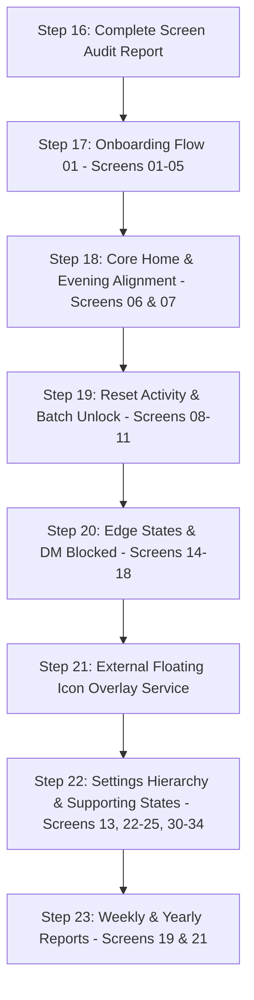

# STILLFEED — Step 16: Complete Figma Screen Audit Report

**Date:** October 13, 2026  
**Auditor:** Antigravity AI Pair Programmer  
**Figma Source:** [Stillfeed — Widget Design System](https://www.figma.com/design/SW3qMYI0E3pnYALuExsdd8/Stillfeed-%E2%80%94-Widget-Design-System?node-id=31-2)  
**Figma Canvas:** `02 — App Design` (Node ID `31:2`)  
**Product Map:** `03 — Final Product Map` (Node ID `79:82`)  
**Design Reference:** `design-reference/skillfeed-floating-icon.html`  
**Target Hardware:** Physical Motorola Edge 60 Fusion (`ZA222WTN4H`, Android 16 / SDK 36, 1220×2712 @ 480dpi)

---

## 1. CURRENT REPOSITORY AND COMMIT INSPECTED

- **Repository:** `https://github.com/gugan207/STILLFEED` (Local workspace `d:\SKILLFEED`)
- **Current Branch:** `main`
- **Latest Commit Hash:** `0b542e0ab653c2b8396e274dccd7e8e1ffaff559`
- **Latest Commit Message:** `docs: record verified physical handset test in step 15 report`
- **Test Suite Health:** All 306/306 unit tests passing (`.\gradlew.bat testDebugUnitTest`), 0 lint errors (`.\gradlew.bat lintDebug`), debug build verified (`app-debug.apk`).
- **Authentication Status:** Preserved working Google Sign-In, Supabase email/password, 6-digit email OTP verification, forgot password deep-link recovery (`stillfeed://reset-password`), and account enumeration safety.
- **Protection Status:** Preserved working `StillfeedAccessibilityService`, `DefaultProtectionEngine`, `CompositeSurfaceClassifier`, and debounced window event processing.

---

## 2. FIGMA FLOWS AND SCREENS REVIEWED

All 10 flows in the Figma design system on page `02 — App Design` (Node `31:2`) and page `03 — Final Product Map` (Node `79:82`) were inspected via the Figma REST API:

| Flow ID | Figma Name | Section Node ID | Screens Contained in Figma |
|---|---|---|---|
| **FLOW 00** | Authentication (Refined) | `286:51` / `265:35` | `00A` Sign In, `00A-L` Loading, `00A-E` Error, `00B` Create Account, `00B-E` Validation, `00C` Verify Code, `00C-E` Wrong Code, `00D` Forgot Password, `00E` Reset Link Sent, `00F` Signed In Preview |
| **FLOW 01** | Onboarding | `99:220` | `01` Welcome, `02` What SKILLFEED Blocks, `03` Permissions, `04` Daily Allowance, `05` Setup Complete |
| **FLOW 02** | Core Experience | `99:221` | `06` Home (Day), `07` Home Evening, `08` Blocked Reel |
| **FLOW 03** | Reset / Reflect / Unlock | `99:222` (`64:2`) | `09` Reset Activity, `10` Awareness Cards, `11` Unlock |
| **FLOW 04** | Insights / Settings / Edge States | `99:223` (`70:112`) | `12` Insights, `13` Settings, `14` Reel from DM Blocked, `15` Daily Limit Reached, `16` Permission Disabled, `17` No Internet, `18` First Day |
| **FLOW 05** | Reports | `146:35` | `19` Weekly Report, `20` Monthly Review, `21` Yearly Report |
| **FLOW 06** | Account / Privacy | `146:37` | `22` Profile & Security, `23` Privacy Center, `24` Data Export |
| **FLOW 07** | Security / Support | `146:39` | `25` App Lock, `26` Help & WhatsApp (Product Map Node `147:30`) |
| **FLOW 08** | Deletion | `146:41` | `27` Delete Account (Map `147:34`), `28` Deletion Pending (Map `147:38`) |
| **FLOW 09** | Supporting Settings States | `153:35` | `29` Edit Profile (Map `153:202`), `30` Change Password, `31` Notifications, `32` Appearance, `33` Active Sessions, `34` Data Export Ready |

---

## 3. COMPLETE SCREEN-MAPPING TABLE

| # | Figma Flow & Screen | Figma Node ID | Corresponding Android Screen / File | Status | Functional Gaps | Visual Differences | Dependencies & Recommended Next Action |
|---|---|---|---|---|---|---|---|
| **00A** | Flow 00: Sign In | `289:307` | `com.stillfeed.app.auth.ui.SignInScreen.kt` | **IMPLEMENTED** | None. GoTrue email/password and Google Sign-In fully operational. | Aligned with Figma tokens, status bar insets, and keyboard handling. | Step 15 verified. Maintain regression tests. |
| **00A-L** | Flow 00: Sign In — Loading | `289:375` | `com.stillfeed.app.auth.ui.AuthGate.kt` (`AuthLoadingSplash`) | **IMPLEMENTED** | None. Splash and inline CTA spinner display during auth session restoration. | Matches Figma loading state. | Maintain regression tests. |
| **00A-E** | Flow 00: Sign In — Error | `289:443` | `com.stillfeed.app.auth.ui.SignInScreen.kt` | **IMPLEMENTED** | None. Handles bad credentials, connection failures, and unverified accounts. | Soft crimson alert banner rendered inline. | Maintain regression tests. |
| **00B** | Flow 00: Create Account | `289:517` | `com.stillfeed.app.auth.ui.CreateAccountScreen.kt` | **IMPLEMENTED** | None. Creates Supabase user and dispatches email OTP. | Form hierarchy and typography match Figma. | Maintain regression tests. |
| **00B-E** | Flow 00: Create Account — Validation | `289:595` | `com.stillfeed.app.auth.ui.CreateAccountScreen.kt` | **IMPLEMENTED** | None. Enforces password complexity (8+ chars, uppercase, number/symbol). | Validation message rendered below inputs. | Maintain regression tests. |
| **00C** | Flow 00: Verify Code | `289:674` | `com.stillfeed.app.auth.ui.VerifyCodeScreen.kt` | **IMPLEMENTED** | None. 6-digit OTP verification via Supabase GoTrue with cooldown timer. | Digit boxes and countdown match Figma. | Maintain regression tests. |
| **00C-E** | Flow 00: Verify Code — Wrong Code | `289:719` | `com.stillfeed.app.auth.ui.VerifyCodeScreen.kt` | **IMPLEMENTED** | None. Shakes/clears input and surfaces invalid code banner. | Exact Figma error styling applied. | Maintain regression tests. |
| **00D** | Flow 00: Forgot Password | `289:770` | `com.stillfeed.app.auth.ui.ForgotPasswordScreen.kt` | **IMPLEMENTED** | None. Dispatches recovery email with 60-second cooldown timer. | Aligned with Figma 00D layout. | Step 15 verified. Maintain regression tests. |
| **00E** | Flow 00: Reset Link Sent | `289:808` | `com.stillfeed.app.auth.ui.ResetLinkSentScreen.kt` | **IMPLEMENTED** | None. Confirms email dispatch with masked email and resend option. | Matches Figma 00E card design. | Step 15 verified. Maintain regression tests. |
| **00-Ext** | Flow 00: Reset Password Entry | Custom deep link | `com.stillfeed.app.auth.ui.ResetPasswordScreen.kt` | **IMPLEMENTED** | None. Intercepts `stillfeed://reset-password` deep link; updates password via GoTrue. | Cohesive with STILLFEED design tokens. | Step 15 verified. Maintain regression tests. |
| **01** | Flow 01: Welcome | `39:2` | `com.stillfeed.app.feature.onboarding` | **MISSING** | Entire onboarding sequence missing; app navigates directly to Home upon sign-in without first-run onboarding check. | No Compose screen exists. | Create `OnboardingScreen.kt` step 1 container. Read `is_onboarded` flag from `AppPreferencesRepository`. |
| **02** | Flow 01: What SKILLFEED Blocks | `39:23` | `com.stillfeed.app.feature.onboarding` | **MISSING** | Missing comparison between "Blocked: Reels/Shorts" and "Kept: DMs + Stories". | No Compose screen exists. | Implement onboarding step 2 slide. |
| **03** | Flow 01: Permissions | `39:41` | `com.stillfeed.app.feature.onboarding` | **MISSING** | No dedicated onboarding permission request step for Accessibility Service and Usage Stats. | `AccessibilityPermissionChecker` exists in code, but has no onboarding presentation. | Implement onboarding step 3 with direct system intent launchers. |
| **04** | Flow 01: Daily Allowance | `39:64` | `com.stillfeed.app.feature.onboarding` | **MISSING** | Missing starting limit selection (default 30 reels) with monthly review cadence info. | No Compose screen exists. | Implement onboarding step 4 with allowance picker. |
| **05** | Flow 01: Setup Complete | `39:84` | `com.stillfeed.app.feature.onboarding` | **MISSING** | Missing summary confirmation ("Your phone can feel quieter now", 30 reels allowance, 06:00-22:00 active hours). | No Compose screen exists. | Implement onboarding step 5 with "Open SKILLFEED" transition to Home. |
| **06** | Flow 02: Home (Day) | `39:103` | `com.stillfeed.app.feature.home.HomeScreen.kt` | **PARTIAL** | Shows monitored minutes (e.g. `42m`) instead of Reel count (`12 reels watched today`); missing "A Little Context" comparison card (`12 today · 19 yesterday · ↓ 7 reels`); missing "YOUR WEEK" mini-rhythm bar; missing "Reset activity" CTA. | Screen currently shows "Protected Apps" and "Monthly Awareness" percentage cards which are NOT in Figma Screen 06. | Refactor `HomeScreen.kt` to mirror Figma Screen 06 hierarchy and reel metrics. |
| **07** | Flow 02: Home Evening | `39:137` | `com.stillfeed.app.feature.home.HomeScreen.kt` | **MISSING** | No time-of-day evening state (triggers at night/evening with "MAKE A LITTLE SPACE" and "You've been here a while"). | No evening variation implemented in Compose. | Add time-aware state provider in `AwarenessViewModel` to toggle day vs evening layout. |
| **08** | Flow 02: Blocked Reel | `39:162` | `com.stillfeed.app.protection.blocking.InterventionActivity.kt` | **PARTIAL** | Current `InterventionActivity` displays a basic "Short video paused" card with "Return" and "Open STILLFEED"; does NOT link to the 30-second Reset activity or unlock loop. | Missing Figma "BLOCKED MOMENT 03 / 03" header, "pause" badge, and "Choose a reset" CTA. | Update `InterventionActivity.kt` layout to match Figma 08 and launch Reset flow. |
| **09** | Flow 03: Reset Activity | `64:7` | None | **MISSING** | No reset activity selection screen (30s pause, breathing exercise, look away). | Screen completely absent. | Build `ResetActivityScreen.kt` with reset choices and timer. |
| **10** | Flow 03: Awareness Cards | `64:46` | `com.stillfeed.app.feature.awareness.AwarenessSelectionScreen.kt` | **PARTIAL / MISALIGNED** | `AwarenessSelectionScreen` in code was built for monthly reduction percentages (5%, 10%, 15%, 20%), whereas Figma 10 is an interactive deck of reflective cards ("Slow the scroll. 01 / 20 cards"). | Visual layout is completely different (monthly percentages vs reflective editorial cards). | Re-architect: Keep monthly targets for Monthly Review (Screen 20) and create `AwarenessCardDeckScreen.kt` for reflection unlock. |
| **11** | Flow 03: Unlock | `64:65` | None | **PARTIAL** | Backend has unlock duration allowance in `UnlockEventEntity`, but UI has no screen to pick batch size ("Unlock 20 reels"). | Screen absent. | Build `UnlockSelectionScreen.kt` allowing user to unlock 10, 15, or 20 reels. |
| **12** | Flow 04: Insights | `70:113` | `com.stillfeed.app.feature.insights.InsightsScreen.kt` | **PARTIAL** | Displays minutes rather than reels; header text and insight card copy differ from Figma. | Daily rhythm bars exist in `DailyRhythmChart.kt` but use duration rather than reel counts. | Align `InsightsScreen.kt` with Figma Screen 12 tokens and reel metrics. |
| **13** | Flow 04: Settings | `70:149` | `com.stillfeed.app.feature.settings.SettingsScreen.kt` | **PARTIAL** | Current `SettingsScreen` is a monolithic list of 6 sections; Figma Screen 13 is a focused screen with 4 toggles (Protected Apps, Stories & DMs, Monthly Limit, Night Mode). | Current screen contains inline export and delete dialogs. | Reorganize Settings into Figma Screen 13 top-level screen with sub-screen navigation to Flows 06-09. |
| **14** | Flow 04: Reel from DM Blocked | `70:184` | `com.stillfeed.app.protection.blocking.InterventionActivity.kt` | **MISSING** | Detection classifies DM surface (`InstagramSurfaceClassifier`), but shows generic intervention rather than dedicated DM message ("Back to messages"). | No dedicated DM block layout. | Add surface-specific branch in `InterventionActivity` for DM reels. |
| **15** | Flow 04: Daily Limit Reached | `70:198` | None | **MISSING** | No edge state screen when an unlocked batch finishes ("That batch is done. You watched 20 reels in this unlock"). | Screen absent. | Implement batch expiration listener and `BatchFinishedScreen.kt`. |
| **16** | Flow 04: Permission Disabled | `70:221` | `com.stillfeed.app.feature.home.HomeScreen.kt` | **PARTIAL** | Home screen shows warning badge, but full edge-state screen ("Your protection is paused. Review permission") is missing. | Screen absent. | Build `PermissionDisabledScreen.kt` or dedicated edge banner. |
| **17** | Flow 04: No Internet | `70:241` | None | **MISSING** | No dedicated offline screen ("You’re offline. That’s okay. Still protected"). | Screen absent. | Implement network monitor listener and offline edge UI. |
| **18** | Flow 04: First Day (Empty State) | `70:261` | `com.stillfeed.app.feature.insights.InsightsScreen.kt` | **PARTIAL** | Handled via partial empty state in Insights, but missing Figma Screen 18 dedicated layout ("Start with noticing. 0 reels watched so far"). | Incomplete empty state card. | Implement Figma Screen 18 layout for new users on day 1. |
| **19** | Flow 05: Weekly Report | `130:19` | None | **MISSING** | No weekly report summary screen (74 reels, ↓ 18%, best day Tuesday, most improved Saturday). | Screen absent. | Build `WeeklyReportScreen.kt` and weekly aggregation service. |
| **20** | Flow 05: Monthly Review | `130:55` | `com.stillfeed.app.feature.awareness.AwarenessSelectionScreen.kt` | **PARTIAL** | Monthly target reduction percentages (5%, 10%, 15%, 20%) exist in code, but are presented as standalone selection rather than a monthly review report with past comparison. | Current screen lacks monthly comparison header ("12% lower Reel use vs recent pattern"). | Connect `AwarenessSelectionScreen.kt` to the Monthly Review report flow. |
| **21** | Flow 05: Yearly Report | `130:85` | None | **MISSING** | No long-term yearly aggregation screen (3,984 reels watched this year, 12-month trend). | Screen absent. | Build `YearlyReportScreen.kt` and yearly aggregator. |
| **22** | Flow 06: Profile & Security | `130:111` | `com.stillfeed.app.feature.settings.SettingsScreen.kt` | **PARTIAL** | User email displayed, but no dedicated Profile screen with Name, Photo, Email, Phone, Password, and Sessions rows. | Embedded in general settings column. | Extract to dedicated `ProfileSecurityScreen.kt`. |
| **23** | Flow 06: Privacy Center | `130:139` | `com.stillfeed.app.feature.settings.SettingsScreen.kt` | **PARTIAL** | Privacy note displayed, but missing categorized privacy breakdown (Account, Profile, Activity, Reports, Support). | Embedded in general settings column. | Build dedicated `PrivacyCenterScreen.kt`. |
| **24** | Flow 06: Data Export | `130:172` | `com.stillfeed.app.feature.settings.components.SettingsDialogs.kt` | **PARTIAL** | Handled via basic dialog; Figma Screen 24 is a full-page screen with Identity Check, ZIP export, and PDF summary options. | Full-page screen vs pop-up dialog. | Upgrade to full `DataExportScreen.kt`. |
| **25** | Flow 07: App Lock | `130:190` | None | **MISSING** | No biometric / 4-digit PIN lock integration on app resume. | Screen absent. | Implement Android `BiometricPrompt` and `AppLockScreen.kt`. |
| **26** | Flow 07: Help & WhatsApp | `147:30` (Map) | None | **MISSING** | Missing support contact / WhatsApp launcher screen. | Only exists as a card in Product Map; no detailed frame in Figma Flow 07 section. | Design and build `SupportScreen.kt` with direct WhatsApp intent. |
| **27** | Flow 08: Delete Account | `147:34` (Map) | `com.stillfeed.app.feature.settings.components.SettingsDialogs.kt` | **IMPLEMENTED AS DIALOG** | Handled via confirmation dialog; deletes Supabase account and local Room DB. | Dialog vs full-screen flow. | Maintain current dialog or create dedicated screen based on product preference. |
| **28** | Flow 08: Deletion Pending | `147:38` (Map) | None | **MISSING** | No grace period / deletion pending screen. | Only exists as a card in Product Map; section `146:41` in Figma has no frame. | Product decision needed: immediate deletion vs grace period. |
| **29** | Flow 09: Edit Profile | `153:202` (Map) | None | **MISSING** | No edit profile screen for updating name and avatar. | Exists in Product Map; frame absent in Figma Flow 09. | Build `EditProfileScreen.kt` connected to Supabase `user_metadata`. |
| **30** | Flow 09: Change Password | `153:40` | None | **MISSING** | Reset password exists for forgot-password, but in-app authenticated password change screen is missing. | Screen absent. | Build `ChangePasswordScreen.kt` with current password verification. |
| **31** | Flow 09: Notifications | `153:43` | None | **MISSING** | No notification preference controls (Daily summary, Weekly summary, Reminders, Quiet hours). | Screen absent. | Build `NotificationSettingsScreen.kt` with WorkManager schedule toggles. |
| **32** | Flow 09: Appearance | `153:46` | None | **MISSING** | App follows system theme, but has no UI screen to manually choose Light (Warm paper), Dark (Low-light), or System. | Screen absent. | Build `AppearanceSettingsScreen.kt` saving theme mode in `AppPreferencesRepository`. |
| **33** | Flow 09: Active Sessions | `153:49` | None | **MISSING** | No active sessions management screen (list devices, remote logout). | Screen absent. | Build `ActiveSessionsScreen.kt` querying Supabase auth sessions. |
| **34** | Flow 09: Data Export Ready | `153:52` | `com.stillfeed.app.feature.settings.components.SettingsDialogs.kt` | **PARTIAL** | Export result currently surfaces via dialog text copy. | Full-page download card vs dialog. | Build `DataExportReadyScreen.kt` with download intent. |

---

## 4. FLOATING-ICON REFERENCE INSPECTION

### 4.1 Visual & Structural Analysis (`design-reference/skillfeed-floating-icon.html`)
The floating icon is a persistent, non-intrusive companion overlay rendered above external applications (Instagram Reels and YouTube Shorts).

1. **Intended Overlay Composition:**
   - **Form Factor:** Compact pill container (geometry ~`300x140px` or proportional density-independent dp ~`150x70dp`).
   - **Visual Elements:**
     - 3D/2D cartoon brain companion face reflecting current emotional state.
     - Real-time integer Reel counter (e.g., `7`, `12`, `24`).
     - Ambient color glow (`#ff9db5` in fresh state) and drop shadow.
     - Floating pill background with rounded corners (`rx="56"`).
   - **The 5 Mood Tiers:**
     - **Fresh (0% of allowance):** Brain `#ff9db5`, pill `#713a00`, number `#ffb15e`, cheerful open eyes and wide smile.
     - **Calm (25% of allowance):** Brain `#f69ab3`, pill `#6c3a07`, number `#fab26a`, calm smile, subtle tilt.
     - **Tired (50% of allowance):** Brain `#e49ab0`, pill `#613a10`, number `#eeb078`, eyelids drooping, flat mouth.
     - **Sad (75% of allowance):** Brain `#c79bb9`, pill `#523a20`, number `#dba886`, downcast eyes, tear drop, downturned mouth.
     - **Worn Out (100%+ of allowance):** Brain `#a39ac0`, pill `#423a33`, number `#bda197`, sleeping `zzz`, tear, maximum slant.

2. **Explicitly Excluded Demo Controls:**
   - In the reference HTML, lines 59–70 contain a demo manipulation bar (`<section class="bar">`).
   - **The final external-app overlay MUST completely exclude:**
     - `−` (minus button)
     - `+` (plus button)
     - Range slider (`input[type=range]`)
     - `Play a day` toggle button
     - `Reset` button
     - Bottom toolbar background and test readouts.
   - The overlay must strictly render the floating companion pill and support dragging/snapping to screen edges.

### 4.2 Data Supply Verification: Count and Mood
- **Verification Question:** Can existing Android usage data supply the icon's displayed count and mood without inventing APIs?
- **Finding:**
  - The Android app currently persists each reel session and block intervention as a `UsageEventEntity` in Room DB.
  - `DailyUsageSummary` computes `blockedInterventionCount: Int`, `sessionCount: Int`, and `totalMonitoredMillis: Long`.
  - **The Missing Metric:** The floating icon requires an integer **`todayReelCount: Int`** (the total number of reels encountered today) and a **`dailyAllowance: Int`** (default 30 reels).
  - Mood calculation is purely mathematical:
    $$\text{Ratio} = \frac{\text{todayReelCount}}{\text{dailyAllowance}}$$
    $$\text{Mood} = \begin{cases} \text{Fresh} & \text{ratio} < 0.25 \\ \text{Calm} & 0.25 \le \text{ratio} < 0.50 \\ \text{Tired} & 0.50 \le \text{ratio} < 0.75 \\ \text{Sad} & 0.75 \le \text{ratio} < 1.00 \\ \text{Worn Out} & \text{ratio} \ge 1.00 \end{cases}$$
  - **Verdict:** Existing event interception can supply `todayReelCount` by incrementing a persistent counter upon each reel surface detection in `StillfeedAccessibilityService`. No synthetic or fabricated APIs are required.

---

## 5. DIFFERENCES REQUIRING PRODUCT DECISION

Before proceeding with implementation, the following three core design divergences must be resolved:

### 1. Primary Usage Metric: "Reels Watched" vs "Monitored Minutes"
- **Figma Design:** Throughout all screens (04, 06, 07, 09, 11, 15, 17, 18, 19, 20, 21) and the floating icon, the primary unit of measurement is **Reels Watched** (e.g., `12 reels watched today`, `30 reels allowance`).
- **Current Codebase:** Measures and displays **Monitored Duration in Minutes** (e.g., `42m today`, `SuperDisplay` minutes counter on Home).
- **Product Decision Needed:** Should STILLFEED adopt **Reels Watched** as the primary hero metric, displaying monitored minutes only as secondary context?

### 2. Intervention Flow: "Interactive Reset & Unlock" vs "Simple Block Activity"
- **Figma Design:** When a reel is blocked (Screen 08), the user enters a reflective reset flow: Screen 08 (Reel Blocked) → Screen 09 (Choose 30s Reset) → Screen 10 (Awareness Card Reflection) → Screen 11 (Unlock 20 Reels).
- **Current Codebase:** `InterventionActivity` simply blocks the screen with a static message and "Return to Feed" / "Open Stillfeed" buttons.
- **Product Decision Needed:** Should `InterventionActivity` transition into the full 3-step Reset Activity & Unlock flow as designed in Figma?

### 3. Settings Architecture: "Compact 4-Toggle Home" vs "Hierarchical Sub-Pages"
- **Figma Design:** Screen 13 is a calm, minimal screen containing only 4 main toggles. Sub-features (Reports, Profile, Privacy, Security, Notifications, Appearance) exist as separate sub-screens (Flows 05–09).
- **Current Codebase:** `SettingsScreen.kt` combines account details, data export, and account deletion into a single scrollable screen.
- **Product Decision Needed:** Should Settings be reorganized into the Figma hierarchy with a clean 4-toggle overview navigating into sub-settings destinations?

---

## 6. MISSING SCREENS AND INCOMPLETE FEATURES SUMMARY

Of the 34 defined Figma journey screens:
- **Fully Implemented (10 screens):**
  - All Flow 00 Authentication screens (00A, 00A-L, 00A-E, 00B, 00B-E, 00C, 00C-E, 00D, 00E, plus Reset Password deep-link entry).
- **Partially Implemented (10 screens):**
  - 06 Home (Day), 08 Blocked Reel, 10 Awareness Cards, 12 Insights, 13 Settings, 16 Permission Disabled, 18 First Day, 20 Monthly Review, 22 Profile & Security, 24 Data Export.
- **Completely Missing (14 screens):**
  - 01 Welcome, 02 What Stillfeed Blocks, 03 Permissions, 04 Daily Allowance, 05 Setup Complete (entire Onboarding flow).
  - 07 Home Evening.
  - 09 Reset Activity, 11 Unlock.
  - 14 Reel from DM Blocked, 15 Daily Limit Reached, 17 No Internet.
  - 19 Weekly Report, 21 Yearly Report.
  - 25 App Lock.
  - 30 Change Password, 31 Notifications, 32 Appearance, 33 Active Sessions.

---

## 7. EVIDENCE AND LIMITATIONS FOR SCREENS THAT COULD NOT BE INSPECTED

During the Figma API document traversal, the following observations and structural limitations were identified:

1. **FLOW 08 — Deletion (Node `146:41`):**
   - The section exists on canvas `31:2` with dimensions `1480x940`, but contains only a single text node (`146:42 | Flow Section Label`).
   - No individual frame children (`27 — Delete Account`, `28 — Deletion Pending`) exist inside section `146:41` on the `02 — App Design` canvas.
   - **Evidence:** Screens 27 and 28 exist solely as roadmap card instances (`147:34` and `147:38`) on canvas `03 — Final Product Map` (`79:82`). Their detailed UI specifications are not drawn in Figma.
2. **Screen 26 — Help & WhatsApp:**
   - Section `146:39 FLOW 07 — Security / Support` contains only `130:190 | 25 — App Lock`.
   - Screen 26 exists solely as a product map card (`147:30`) on canvas `03 — Final Product Map`.
3. **Screen 29 — Edit Profile:**
   - Exists as a product map card (`153:202`) on canvas `03 — Final Product Map`, but no dedicated frame is present in section `153:35`.

---

## 8. RECOMMENDED IMPLEMENTATION ORDER

To maintain high code quality, preserve existing authentication and accessibility mechanisms, and allow continuous physical verification on the Motorola Edge 60 Fusion, implementation should proceed in small, self-contained steps:

### Detailed Breakdown:
1. **Step 17 — Onboarding Flow (Screens 01–05):**
   - Implement `OnboardingScreen.kt` with a 5-step pager (Welcome → What Stillfeed Blocks → Permissions → Daily Allowance → Setup Complete).
   - Wire `is_onboarded` flag into `AppPreferencesRepository` and update `StillfeedNavHost` start destination.
2. **Step 18 — Core Home & Evening Alignment (Screens 06 & 07):**
   - Refactor `HomeScreen.kt` to display reel count hero metrics, companion mood card, yesterday comparison, and weekly mini-rhythm bar.
   - Implement time-of-day evening variation ("MAKE A LITTLE SPACE").
3. **Step 19 — Reset Activity & Batch Unlock (Screens 08–11):**
   - Update `InterventionActivity.kt` to launch `ResetActivityScreen.kt` (Screen 09).
   - Implement `AwarenessCardDeckScreen.kt` (Screen 10) for reflection cards.
   - Implement `UnlockSelectionScreen.kt` (Screen 11) to unlock batches of reels.
4. **Step 20 — Edge States & DM Intervention (Screens 14–18):**
   - Implement dedicated DM Blocked layout (`Reel from DM Blocked`).
   - Implement `BatchFinishedScreen` (Daily Limit Reached), `PermissionDisabledScreen`, `NoInternetScreen`, and day 1 empty state.
5. **Step 21 — External Floating Icon Overlay Service:**
   - Implement Android `WindowManager` overlay service (`TYPE_APPLICATION_OVERLAY`) rendering the 3D/2D cartoon companion and reel counter.
   - Strictly exclude demo toolbar controls.
   - Connect live reel count and mood tier calculation.
6. **Step 22 — Settings & Supporting Screens (Screens 13, 22–25, 30–34):**
   - Refactor Settings into the clean 4-toggle screen.
   - Add sub-destinations for Profile, Privacy, App Lock (biometric), Change Password, Notifications, and Appearance.
7. **Step 23 — Reports (Screens 19 & 21):**
   - Implement Weekly Report and Yearly Report data aggregators and Compose screens.

---

## 9. PHYSICAL ANDROID DEVICE TEST PLAN

All subsequent implementation steps will be verified against the physical Motorola Edge 60 Fusion (`ZA222WTN4H`, Android 16 / SDK 36):

1. **Visual & Inset Regression Testing:**
   - Verify zero clipping with Android 16 gesture bar and camera punch-hole cutout using `Scaffold(bottomBar = ...)` and `navigationBarsPadding()`.
   - Verify keyboard interactions on text entry forms with `imePadding()`.
2. **Overlay Permission & Window Management:**
   - Verify `SYSTEM_ALERT_WINDOW` permission request and dragging/edge-snapping of the floating icon overlay over Instagram and YouTube.
3. **Accessibility Performance & Memory:**
   - Monitor `StillfeedAccessibilityService` CPU/memory footprint via ADB to ensure zero memory leaks during rapid Reel scrolling.
4. **Navigation Back-Stack Integrity:**
   - Verify back-press navigation from sub-screens (Reset, Unlock, Reports, Settings) cleanly anchors to Home.

---

## 10. SINGLE RECOMMENDED NEXT IMPLEMENTATION STEP

**Recommended Next Step:** **STEP 17 — Flow 01: Onboarding Implementation (Screens 01–05)**

### Rationale:
- Onboarding is the primary user entry point immediately following authentication.
- Currently, `com/stillfeed/app/feature/onboarding/` is an empty directory. When a new user signs up, they are immediately dropped into the Home dashboard without establishing their baseline allowance (30 reels), understanding what STILLFEED blocks, or configuring accessibility permissions.
- Building Step 17 establishes the first-launch flag, sets the initial daily allowance, and smoothly bridges authentication into the core protected experience.

**Status:** Awaiting review and approval before proceeding with Step 17 implementation.
