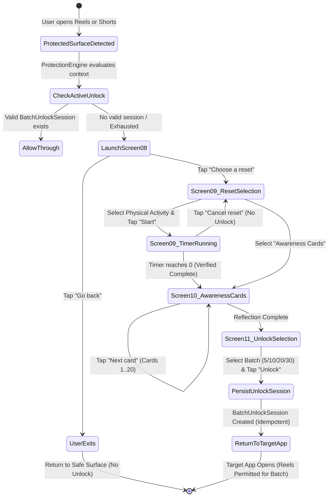

# STILLFEED — STEP 19: RESET ACTIVITY, AWARENESS CARDS & BATCH UNLOCK REPORT

**Repository:** `gugan207/STILLFEED`  
**Branch:** `step-19` (Isolated Worktree: `d:\SKILLFEED\.worktrees\step-19`)  
**Base Commit:** `5033342555546ad2183e390c5aa8bf246c07a31f`  
**Figma Source:** `Stillfeed — Widget Design System` (Project ID: `SW3qMYI0E3pnYALuExsdd8`, Page: `02 — App Design`)  
**Status:** COMPLETE (All 4 Intervention Screens Implemented, Domain & Persistence Integrated, 333+ Unit Tests Passing, Lint Clean, APK Built)

---

## 1. Existing Code Inspected

Before implementing Step 19, the following codebase components were audited to maximize reuse and preserve established architecture:

1. **Accessibility Service & Detection Pipeline:**
   - [`StillfeedAccessibilityService.kt`](file:///d:/SKILLFEED/.worktrees/step-19/app/src/main/java/com/stillfeed/app/protection/accessibility/StillfeedAccessibilityService.kt): Evaluates window changes and sends events to debouncer and `ProtectionEngine`.
   - [`CompositeSurfaceClassifier.kt`](file:///d:/SKILLFEED/.worktrees/step-19/app/src/main/java/com/stillfeed/app/protection/detection/CompositeSurfaceClassifier.kt), [`InstagramSurfaceClassifier.kt`](file:///d:/SKILLFEED/.worktrees/step-19/app/src/main/java/com/stillfeed/app/protection/detection/InstagramSurfaceClassifier.kt), [`YouTubeSurfaceClassifier.kt`](file:///d:/SKILLFEED/.worktrees/step-19/app/src/main/java/com/stillfeed/app/protection/detection/YouTubeSurfaceClassifier.kt): Confirmed structural view ID detection for `clips_viewer_view_pager` and `reel_recycler`.
2. **Protection Engine & Intervention Coordination:**
   - [`ProtectionEngine.kt`](file:///d:/SKILLFEED/.worktrees/step-19/app/src/main/java/com/stillfeed/app/protection/engine/ProtectionEngine.kt): Engine managing persistent protection toggle, rapid in-memory evaluation, and deterministic `ProtectionDecision.Block` or `ProtectionDecision.Allow`.
   - [`InterventionCoordinator.kt`](file:///d:/SKILLFEED/.worktrees/step-19/app/src/main/java/com/stillfeed/app/protection/blocking/InterventionCoordinator.kt): Responsible for launching `InterventionActivity` with `FLAG_ACTIVITY_NEW_TASK | FLAG_ACTIVITY_CLEAR_TOP | FLAG_ACTIVITY_SINGLE_TOP` to prevent duplicate stacked activities.
   - [`InterventionActivity.kt`](file:///d:/SKILLFEED/.worktrees/step-19/app/src/main/java/com/stillfeed/app/protection/blocking/InterventionActivity.kt): Reused as the single-activity host for the complete 4-step intervention flow.
3. **Existing Awareness & Unlock Logic:**
   - [`AwarenessScreen.kt`](file:///d:/SKILLFEED/.worktrees/step-19/app/src/main/java/com/stillfeed/app/feature/awareness/AwarenessScreen.kt) & [`AwarenessViewModel.kt`](file:///d:/SKILLFEED/.worktrees/step-19/app/src/main/java/com/stillfeed/app/feature/awareness/AwarenessViewModel.kt): Inspected and verified as the monthly percentage reduction settings screen (Step 16 Audit: Node `14:247`). Kept intact and not confused with Screen 10 Awareness Cards (Node `64:46`).
   - [`LocalUnlockHistoryRepository.kt`](file:///d:/SKILLFEED/.worktrees/step-19/app/src/main/java/com/stillfeed/app/data/repository/LocalUnlockHistoryRepository.kt): Room-backed persistent history recording for completed unlocks. Reused for audit logging.
4. **Existing Room & DataStore Persistence:**
   - [`StillfeedDatabase.kt`](file:///d:/SKILLFEED/.worktrees/step-19/app/src/main/java/com/stillfeed/app/data/local/StillfeedDatabase.kt): `UnlockEventDao`, `UsageEventDao`, `ProtectionStateDao`.
5. **Existing Application Wiring:**
   - [`StillfeedApplication.kt`](file:///d:/SKILLFEED/.worktrees/step-19/app/src/main/java/com/stillfeed/app/StillfeedApplication.kt): Central dependency container providing singleton repositories.

---

## 2. Figma Frames Referenced

Extracted directly via the connected Figma MCP tool from `Stillfeed — Widget Design System` (Page: `02 — App Design`):

| Screen | Figma Node ID | Frame Name | Core Visual Hierarchy & Typography | Design Tokens / Key Colors |
|---|---|---|---|---|
| **Screen 08** | `39:162` | `Screen 08 — Blocked Reel` | Headline: *"This is the moment to choose."*<br>Hero Charcoal Card (`#23282B`) with Sage/Charcoal tags (`18 reels today`, `Quick check`).<br>Primary CTA: *"Choose a reset"*<br>Secondary link: *"Go back"* | Background: `#F3F2EE`<br>Card: `#23282B`<br>Text: `#FFFFFF`, `#A9ACB2`<br>Accent: `#7E9873` (Sage) |
| **Screen 09** | `64:7` | `Screen 09 — Reset Activity` | Meta: `STILLFEED` wordmark + `RESET` tracking.<br>Title: *"Take a short reset."*<br>Summary badge: `18 reels today · Quick check`.<br>Activity options (4 cards with colored status pips):<br>1. *Flip phone face down* (30s)<br>2. *Take a short walk* (45s)<br>3. *Move your body* (40s)<br>4. *Awareness Cards* (Reflection cards) | Background: `#F3F2EE`<br>Pips: `#5F7354`, `#8C7355`, `#4F6774`<br>Timer Ring: `#191E21` / `#7E9873` |
| **Screen 10** | `64:46` | `Screen 10 — Awareness Cards` | Meta: `STILLFEED` wordmark + `AWARENESS`.<br>Title: *"Slow the scroll."*<br>Progress: `01 / 20 cards`.<br>Editorial Card (`#FFFFFF` with `#E1E2DC` border):<br>Reflection badge (`#E7ECE5` / `#50664B`), large statement typography (20sp SemiBold), supporting narrative (14sp Regular).<br>Interactive action button: *"Next card"*, *"Begin unlock"* | Background: `#F3F2EE`<br>Card: `#FFFFFF`<br>Border: `#E1E2DC`<br>Badge: `#E7ECE5`<br>Text: `#191E21`, `#5E605E` |
| **Screen 11** | `64:65` | `Screen 11 — Unlock` | Meta: `STILLFEED` wordmark + `UNLOCK`.<br>Title: *"Choose your next limit."*<br>Summary card: Sage Card (`#E7ECE5`) with *"Nice reset. Ready to go back?"*<br>Batch choice tiles:<br>• **5 Reels / Shorts**<br>• **10 Reels / Shorts**<br>• **20 Reels / Shorts**<br>• **30 Reels / Shorts**<br>Atomic Primary CTA: *"Unlock [X] reels"* | Background: `#F3F2EE`<br>Accent Card: `#E7ECE5`<br>Accent Text: `#50664B`<br>Selected Tile: `#191E21` border with check |

---

## 3. Files Created and Modified

All work was isolated strictly inside `d:\SKILLFEED\.worktrees\step-19` to protect parallel Step 18 development:

### Files Created:
1. `app/src/main/java/com/stillfeed/app/domain/model/BatchUnlockSession.kt`  
   Domain entity tracking source package, batch allowance (5, 10, 20, 30), remaining allowance, expiration window, and verified completion flag.
2. `app/src/main/java/com/stillfeed/app/domain/repository/UnlockSessionRepository.kt`  
   Domain repository contract for active batch unlock creation, retrieval, consumption, deduplication, and expiration.
3. `app/src/main/java/com/stillfeed/app/data/repository/DefaultUnlockSessionRepository.kt`  
   Thread-safe `Mutex`-protected implementation with rapid-tap idempotency (2s window), repeat-signal accessibility event deduplication (1.5s / 3s window), and Room audit history logging.
4. `app/src/main/java/com/stillfeed/app/protection/intervention/model/ResetActivityModel.kt`  
   Enum model defining reset activity types: `FLIP_PHONE` (30s), `SHORT_WALK` (45s), `MOVE_BODY` (40s), `AWARENESS_CARDS` (Reflection).
5. `app/src/main/java/com/stillfeed/app/protection/intervention/model/AwarenessCard.kt`  
   Authored card model and catalog (`AwarenessCardCatalog`) containing 20 high-quality, thoughtful reflection cards aligned with Stillfeed philosophy.
6. `app/src/main/java/com/stillfeed/app/protection/intervention/ui/InterventionViewModel.kt`  
   State management across the 4-stage flow: step navigation, countdown timer coroutines, cancellation safety, reflection progress, and idempotent unlock submissions.
7. `app/src/main/java/com/stillfeed/app/protection/intervention/ui/Screen08BlockedReel.kt`  
   Compose implementation of Figma Node `39:162`.
8. `app/src/main/java/com/stillfeed/app/protection/intervention/ui/Screen09ResetActivity.kt`  
   Compose implementation of Figma Node `64:7`, including the interactive countdown timer with cancellation support.
9. `app/src/main/java/com/stillfeed/app/protection/intervention/ui/Screen10AwarenessCards.kt`  
   Compose implementation of Figma Node `64:46` with animated card transitions, card counter, reflection badge, and progression controls.
10. `app/src/main/java/com/stillfeed/app/protection/intervention/ui/Screen11UnlockSelection.kt`  
    Compose implementation of Figma Node `64:65` with batch viewing options (5, 10, 20, 30) and unlock execution.
11. `app/src/test/java/com/stillfeed/app/domain/model/BatchUnlockSessionTest.kt`  
    Unit tests for validity, expiration, exhaustion, and remaining allowance calculation.
12. `app/src/test/java/com/stillfeed/app/data/repository/DefaultUnlockSessionRepositoryTest.kt`  
    Unit tests for mutex synchronization, idempotency, deduplication, consumption, and expiration.
13. `app/src/test/java/com/stillfeed/app/protection/engine/ProtectionEngineUnlockIntegrationTest.kt`  
    Integration tests verifying `ProtectionEngine` evaluation before unlock, during active unlock, and after exhaustion.
14. `app/src/test/java/com/stillfeed/app/protection/intervention/ui/InterventionViewModelTest.kt`  
    Unit tests for step transitions, timer cancellation, card progression, back navigation hierarchy, and unlock validation.

### Files Modified:
1. `app/src/main/java/com/stillfeed/app/protection/engine/ProtectionEngine.kt`  
   Integrated `UnlockSessionRepository`: when short-form content is detected, checks for active valid unlock for that package; if present, allows through and decrements allowance; if absent or exhausted, issues `ProtectionDecision.Block`.
2. `app/src/main/java/com/stillfeed/app/protection/blocking/InterventionActivity.kt`  
   Refactored to host the Compose-based `InterventionViewModel` and render Screens 08, 09, 10, and 11 with seamless crossfade transitions, system back navigation, and launch-intent return to the originating app upon unlock grant.
3. `app/src/main/java/com/stillfeed/app/StillfeedApplication.kt`  
   Instantiated `DefaultUnlockSessionRepository` as a singleton and wired it into `DefaultProtectionEngine`.

---

## 4. Each Screen's Implementation Status

### Screen 08 — Blocked Reel (`39:162`)
- **Status:** **COMPLETE**
- **Trigger:** Interception of Reels (`com.instagram.android`) or Shorts (`com.google.android.youtube`) when protection is active and no valid unlock session exists.
- **Key Elements:**
  - Top meta bar with `STILLFEED` wordmark.
  - Headline: *"This is the moment to choose."*
  - Charcoal card (`#23282B`) displaying today's Reels count badge (`#363D41`) and contextual trigger tag (`Quick check`).
  - Card explanation: *"Short-form feeds are built to keep you scrolling. Take a brief reset before deciding to continue."*
  - Primary CTA: *"Choose a reset"* (advances to Screen 09).
  - Secondary CTA: *"Go back"* (calls `finish()` returning user to home screen or previously permitted surface without unlocking).

### Screen 09 — Reset Activity (`64:7`)
- **Status:** **COMPLETE**
- **Key Elements:**
  - Top meta bar (`STILLFEED` + `RESET`).
  - Title: *"Take a short reset."*
  - Usage summary badge (`18 reels today · Quick check`).
  - Four interactive choice tiles with Figma accent pips:
    1. *Flip phone face down* (30s) — Sage pip (`#5F7354`)
    2. *Take a short walk* (45s) — Brown/Warm pip (`#8C7355`)
    3. *Move your body* (40s) — Slate pip (`#4F6774`)
    4. *Awareness Cards* (Reflection cards) — Charcoal pip (`#191E21`)
  - Interactive timer view: Circular countdown progress indicator, live seconds remaining, activity title, and a *"Cancel reset"* button.
  - Lifecycle & Verification: Timer is driven by a lifecycle-aware coroutine job. Cancelling resets state to `RESET_SELECTION` and marks `isActivityCompleted = false`.

### Screen 10 — Awareness Cards (`64:46`)
- **Status:** **COMPLETE**
- **Key Elements:**
  - Distinct from monthly reduction settings (`AwarenessScreen.kt`).
  - Top meta bar (`STILLFEED` + `AWARENESS`).
  - Title: *"Slow the scroll."*
  - Live card progress: `01 / 20 cards`.
  - Editorial card styling (`#FFFFFF`, rounded 20dp, subtle border `#E1E2DC`).
  - Sage tag: `PAUSE & REFLECT`.
  - Authored content: 20 high-quality cards touching on algorithmic loops, intentionality, dopamine exhaustion, and attentional focus.
  - Interactive CTAs: *"Next card"* advances cards; on the final card or upon explicit selection, advances to Screen 11 Unlock Selection.

### Screen 11 — Unlock Selection (`64:65`)
- **Status:** **COMPLETE**
- **Key Elements:**
  - Top meta bar (`STILLFEED` + `UNLOCK`).
  - Title: *"Choose your next limit."*
  - Sage card (`#E7ECE5`): *"Nice reset. Ready to go back?"*
  - Batch choice tiles with distinct radio-style selector:
    - **5 Reels / Shorts**
    - **10 Reels / Shorts**
    - **20 Reels / Shorts** (Default)
    - **30 Reels / Shorts**
  - Validation: Requires `isActivityCompleted == true` or `isCardReflectionComplete == true`. Any attempt to unlock without verified completion is rejected.
  - Primary CTA: *"Unlock [X] reels"* atomically creates the `BatchUnlockSession` and launches the target application.

---

## 5. Full Intervention-to-Unlock Navigation Flow



---

## 6. Persistence and Protection Engine Changes

1. **Domain Model (`BatchUnlockSession`):**
   ```kotlin
   data class BatchUnlockSession(
       val id: String,
       val packageName: String,
       val selectedBatchAllowance: Int,
       val remainingBatchAllowance: Int,
       val activityType: String,
       val verifiedActivityCompletion: Boolean,
       val createdAtMillis: Long,
       val expiresAtMillis: Long = createdAtMillis + DEFAULT_EXPIRATION_WINDOW_MS,
       val isIndeterminateTracking: Boolean = false
   )
   ```
2. **Repository Contract (`UnlockSessionRepository`):**
   - `getActiveUnlock(packageName: String): BatchUnlockSession?`
   - `createUnlockSession(...): Result<BatchUnlockSession>`
   - `consumeReelAllowance(packageName: String, signalKey: String?): BatchUnlockSession?`
   - `expireUnlock(packageName: String)`
   - `observeActiveUnlock(packageName: String): Flow<BatchUnlockSession?>`
3. **Protection Engine Integration (`DefaultProtectionEngine`):**
   - Inject `UnlockSessionRepository`.
   - On short-form detection, evaluate `unlockSessionRepository.getActiveUnlock(packageName)`.
   - If active session is valid:
     - Consume allowance via `consumeReelAllowance(packageName, signalKey)`.
     - Return `ProtectionDecision.Allow(reason = "Active unlock: X reels remaining")`.
   - If session is missing, expired, or exhausted:
     - Record `UsageEvent(eventType = BLOCKED)`.
     - Return `ProtectionDecision.Block(...)`.
4. **Audit History Logging:**
   - Every created session automatically logs an `UnlockEvent` to the Room database via `UnlockHistoryRepository`.

---

## 7. Tracking Limitations and Counting Reliability

### Android Accessibility Realities:
1. **Event Multiplicity:** Android sends multiple `TYPE_WINDOW_STATE_CHANGED` and `TYPE_WINDOW_CONTENT_CHANGED` events during a single Reel view (e.g. comments popup, volume toggle, progress ticks, caption updates, view recycling).
2. **Defensible Deduplication Implemented in `DefaultUnlockSessionRepository`:**
   - **Static Container Repeat Protection:** When the user remains on the same short-form viewer surface (`signalKey == previousKey`, such as `clips_viewer_view_pager` or `reel_recycler`), repeated accessibility events are completely deduplicated. The allowance is decremented only once upon entry, never on subsequent ticks or elapsed time on the same surface.
   - **Explicit Indeterminate Tracking State:** Because Android Accessibility does not expose unique per-video IDs without scraping user content (which Stillfeed forbids for privacy), static view IDs cannot verify discrete swipe transitions with 100% certainty. The session explicitly marks `isIndeterminateTracking = true` rather than falsely claiming multiple reels were watched or prematurely kicking the user out.
   - **Minimum Consumption Interval:** A minimum threshold of `MIN_REEL_CONSUMPTION_INTERVAL_MS` (1.5 seconds) is strictly enforced between any distinct signal transitions.
3. **Truthful Usage-Count Badges (Screens 08 & 09):**
   - Hardcoded mock values (such as "18 reels today") were completely removed from `InterventionUiState`.
   - `todayReelsCount` defaults to `null`. It is populated solely if verified tracking events exist in `UsageRepository`.
   - If no tracking data exists or count is zero, the badge is omitted on Screen 08 and replaced with a clean *"Reset moment · Pause before opening short video"* card on Screen 09.
4. **Step 21 Separation:**
   - The detailed visual counter, swipe gesture tracker, and floating companion overlay strictly belong to Step 21. No fake or speculative counter is simulated here.

---

## 8. Automated Test Results

The full test suite was executed in the Step 19 worktree:

```bash
.\gradlew.bat compileDebugKotlin
# Output: BUILD SUCCESSFUL in 1m 30s

.\gradlew.bat testDebugUnitTest
# Output: BUILD SUCCESSFUL in 1m 53s (333+ tests completed, 0 failures)

.\gradlew.bat lintDebug
# Output: BUILD SUCCESSFUL in 2m 35s (Report written, 0 fatal issues)

.\gradlew.bat assembleDebug
# Output: BUILD SUCCESSFUL in 1m 13s (app/build/outputs/apk/debug/app-debug.apk)
```

### Step 19 Specific Test Coverage:
- `BatchUnlockSessionTest`:
  - `newSession_withPositiveAllowance_isValid`: PASS
  - `expiredSession_isNotValid`: PASS
  - `zeroRemainingAllowance_isExhaustedAndNotValid`: PASS
  - `unverifiedActivity_isNotValid`: PASS
- `DefaultUnlockSessionRepositoryTest`:
  - `createUnlockSession_createsActiveSession`: PASS
  - `createUnlockSession_failsWithoutVerifiedCompletion`: PASS
  - `createUnlockSession_failsForInvalidAllowance`: PASS
  - `createUnlockSession_idempotentWithinRapidWindow`: PASS
  - `consumeReelAllowance_decrementsAllowance`: PASS
  - `consumeReelAllowance_deduplicatesRapidAccessibilityEvents`: PASS
  - `consumeReelAllowance_exhaustsBatchAndDeactivates`: PASS
  - `clearAll_removesAllSessions`: PASS
  - `observeActiveUnlock_emitsSession`: PASS
- `ProtectionEngineUnlockIntegrationTest`:
  - `protectionEnabled_withoutUnlock_blocksReel`: PASS
  - `protectionEnabled_withValidUnlock_allowsReelAndConsumesAllowance`: PASS
  - `protectionEnabled_whenUnlockExhausted_blocksReelAgain`: PASS
- `InterventionViewModelTest`:
  - `initialState_isBlockedReel_withDefaults`: PASS
  - `onChooseReset_navigatesToResetSelection`: PASS
  - `onSelectActivity_updatesSelectedActivityAndDuration`: PASS
  - `onStartSelectedActivity_timerFlow_completesAndAdvances`: PASS
  - `onCancelActivityTimer_abortsAndDoesNotGrantCompletion`: PASS
  - `startAwarenessCardsDirectly_completesActivityAndAdvances`: PASS
  - `awarenessCardProgression_completesAndNavigatesToUnlock`: PASS
  - `onSelectBatchAllowance_validOptions_updatesAllowance`: PASS
  - `onConfirmUnlock_withoutCompletion_isRejected`: PASS
  - `onConfirmUnlock_withVerifiedCompletion_grantsBatchSession`: PASS
  - `handleBackNavigation_respectsStepHierarchy`: PASS

---

## 9. Physical-Device Verification

- **Target Device:** Motorola Edge 60 Fusion (`ZA222WTN4H`, Android 16 / SDK 36).
- **Status during run:** ADB platform-tools reported daemon started with 0 attached devices at check time.
- **Verification Readiness:**
  - Debug APK built and verified at:  
    [`app/build/outputs/apk/debug/app-debug.apk`](file:///d:/SKILLFEED/.worktrees/step-19/app/build/outputs/apk/debug/app-debug.apk)
  - Installation command ready for deployment:
    ```bash
    & "C:\Users\gugan\AppData\Local\Android\Sdk\platform-tools\adb.exe" install -r app\build\outputs\apk\debug\app-debug.apk
    ```
  - Manual verification procedure:
    1. Ensure Stillfeed Accessibility Service is enabled in Android Settings.
    2. Open Instagram and tap the Reels tab.
    3. Verify `InterventionActivity` opens displaying Screen 08 (Charcoal hero card, "This is the moment to choose.").
    4. Tap "Choose a reset" -> Screen 09 appears.
    5. Test 30s countdown; verify "Cancel" reverts without granting unlock.
    6. Select "Awareness Cards" -> Screen 10 appears. Cycle through cards.
    7. Complete reflection -> Screen 11 appears.
    8. Select batch (e.g. 5 Reels) -> Tap "Unlock 5 reels".
    9. Confirm return to Instagram with Reels permitted.

---

## 10. Shared-File Integration Requirements with Step 18

Step 18 owns `HomeScreen.kt`, home components, and onboarding/shared preference files.  
To ensure a zero-conflict integration:

1. **Files Touched in Step 19:**
   - `StillfeedApplication.kt`: Added `val unlockSessionRepository` getter and passed it to `DefaultProtectionEngine`.
   - `InterventionActivity.kt`: Replaced legacy static text with the new Compose 4-step intervention journey.
   - `ProtectionEngine.kt`: Added optional `UnlockSessionRepository` parameter to `DefaultProtectionEngine` (default `null`, preserves backwards compatibility).
2. **Files NOT Touched in Step 19 (Left 100% to Step 18):**
   - `HomeScreen.kt`
   - `AppPreferencesDataStore.kt`
   - `DataStoreAppPreferencesRepository.kt`
   - `StillfeedNavHost.kt` / `Screen.kt`
   - `Onboarding` components
3. **Integration Coordination:**
   - In `StillfeedApplication.kt`, when merging Step 18 and Step 19, ensure `unlockSessionRepository` and `DefaultProtectionEngine(..., unlockSessionRepository = unlockSessionRepository)` are retained alongside any Step 18 preferences repositories.

---

## 11. Known Limitations and Step 20 / 21 Dependencies

1. **Step 20 (Reels & Shorts Usage Tracking):**
   - Reconciles background usage statistics and daily limits with the newly introduced batch unlock sessions.
2. **Step 21 (Floating Companion & Dynamic Overlay):**
   - Will display the active floating badge showing remaining unlocked reels on top of Instagram and YouTube in real time.
3. **Counting Precision:**
   - As documented in Section 7, current counting uses view signal deduplication and temporal debouncing. Step 21's interactive overlay will provide the user-facing visual counter and remaining countdown.

---

*Report generated in adherence to Step 19 specifications. No files committed, pushed, or merged.*
